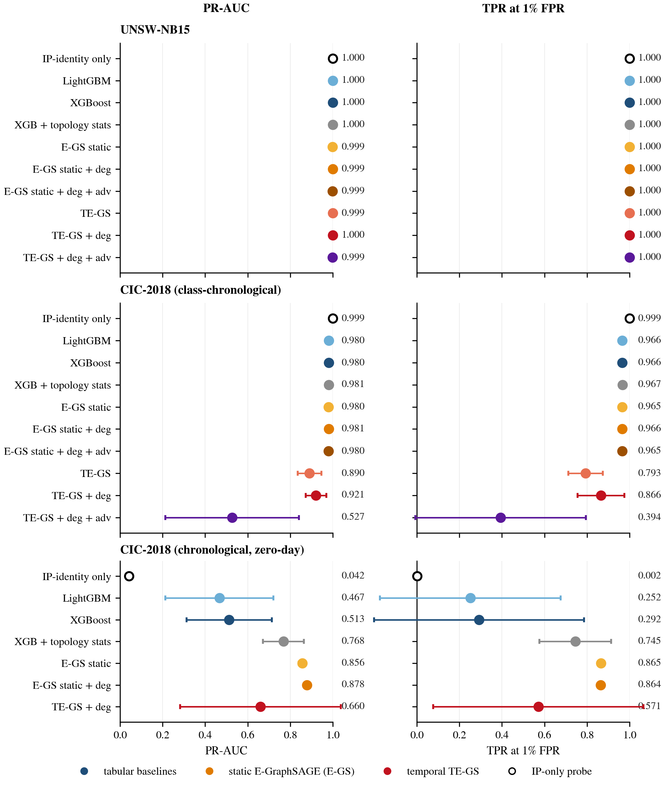

# GNN-IDS: Graph Neural Networks for Network Intrusion Detection under a Leakage-Audited Protocol

Computer Networks research project, FAST-NUCES Islamabad (Fall 2026). Phase 3 report: [docs/Phase3\_Implementation\_and\_Evaluation.pdf](http://docs/Phase3_Implementation_and_Evaluation.pdf).

This repository evaluates whether graph modelling improves flow-based network intrusion detection once the evaluation is audited for leakage and dataset shortcuts. It provides a reproducible benchmark on two NetFlow-v3 datasets (NF-UNSW-NB15-v3 and NF-CSE-CIC-IDS2018-v3), tuned tabular baselines, a static and a temporal edge-aware GraphSAGE (E-GraphSAGE / TE-GS), structural adversarial training, and diagnostics that expose benchmark saturation.

## Main findings

|  | Result |
| :---- | :---- |
| Saturation | On NF-UNSW-NB15-v3 a single column (`MIN_TTL`/`MAX_TTL`) separates attacks with ROC-AUC 1.000, an IP-identity-only model scores PR-AUC 1.000 (the prepared data contain 39 hosts), and dropping the ten most important features leaves ROC-AUC 1.000. In-distribution scores cannot rank models. Shuffled labels give ROC-AUC 0.41 to 0.47, so the scores do not come from a pipeline leak. |
| Duplicates | 32.4% (UNSW), 13.0% (CIC chronological) and 16.2% (CIC class-chronological) of test flows have a feature vector that also occurs in training. Scores change little on UNSW and CICc but by up to 0.21 PR-AUC on the CIC chronological split; both versions are reported. |
| Zero-day split (CIC-2018, chronological, 3 seeds) | The test period contains Bot (86% of attacks, unseen in training) and Infiltration. Static E-GraphSAGE reaches PR-AUC 0.856 ± 0.017, and 0.878 ± 0.002 with degree features, against XGBoost 0.513 ± 0.200, LightGBM 0.467 ± 0.254 and XGBoost with topology statistics 0.768 ± 0.096. TE-GS with degree features reaches 0.660 ± 0.378 (one of three seeds did not converge; the other two give 0.877 and 0.880). No model detects Infiltration. |
| Operating point | Validation data in this split contain only Infiltration, so thresholds carry no information about Bot. XGBoost at the validation-F1 threshold predicts almost everything benign; at the 1%-false-alarm operating point it recovers the attacks in one seed of three (attack recall 0.86, 0.01, 0.00), the static graph models in all three (0.86). |
| In-distribution | Static graph models and tuned tabular models are indistinguishable (CIC-2018 class-chronological: static \+ degree 0.981, XGBoost 0.980). TE-GS reaches 0.890 to 0.921; adversarial training lowers it to 0.527. |
| Recurrent memory | Cold-start PR-AUC is close to warm PR-AUC (UNSW 0.999 / 0.999; CIC-2018 class-chronological 0.890 / 0.843 for TE-GS, 0.921 / 0.918 with degree features). In leave-one-family-out the memory model fails on the withheld Bot family (ROC-AUC 0.46) where the static model reaches 1.00 (one seed). |
| Structural robustness (UNSW, 3 seeds) | At 100 injected edges, detection of models without adversarial training falls to 0.29 to 0.88 in some seeds; with adversarial training it stays at 0.998 or higher, also for the held-out victim-side family. On CIC-2018 adversarial training does not improve attacker-side robustness. |
| Transfer | Static E-GraphSAGE with degree features transfers from CIC-2018 (chronological) to UNSW-NB15 with PR-AUC 0.574 ± 0.339 (3 seeds; 0.882 ± 0.069 in a CPU re-run with a shared log-transform) against 0.055 for XGBoost and 0.119 for LightGBM (chance 0.067). Transfer between the class-chronological split and UNSW-NB15 is weaker and varies strongly by seed. |
| Flow features | With the flow features hidden (`--no_edge`), static E-GraphSAGE with degree features still reaches PR-AUC 0.905 ± 0.000 on the zero-day split (0.878 ± 0.002 with them) and 0.976 on CIC-2018 class-chronological, but only 0.910 ± 0.033 on UNSW-NB15. Encoder depth (1, 2, 3 layers) changes nothing beyond the seed spread. |
| Streaming | One event takes about 1.2 to 1.4 ms (p95, forward pass) on CPU; the GPU is slower for single events. |

Details, tables and limitations: [docs/RESULTS.md](http://docs/RESULTS.md). Method: [docs/METHODOLOGY.md](http://docs/METHODOLOGY.md).



## Installation

```sh
git clone <https://github.com/aymanirshad/GNN-IDS.git> && cd GNN-IDS
pip install -r requirements.txt
python -m pytest -q tests          # unit tests, no data required
```

A GPU is recommended for the graph models (a Google Colab T4 is sufficient); baselines run on CPU.

## Data

Download `NF-UNSW-NB15-v3` and `NF-CSE-CIC-IDS2018-v3` from the University of Queensland NetFlow dataset page ([https\://staff.itee.uq.edu.au/marius/NIDS\_datasets](https://staff.itee.uq.edu.au/marius/NIDS_datasets)). Cite: Luay et al., *Temporal analysis of NetFlow datasets for network intrusion detection systems*, arXiv:2503.04404. The CSV files are not part of this repository.

## Usage

```sh
# 1. prepare: time ordering, purge gap, train-only scaling, leakage audit
python -m gnnids prep --csv NF-UNSW-NB15-v3.csv --out data/UNSW --chunksize 500000 --keep_per_chunk 100000 --max_rows 1000000
python -m gnnids prep --csv NF-CICIDS2018-v3.csv --out data/CIC  --chunksize 500000 --keep_per_chunk 25000  --max_rows 1000000
python -m gnnids resplit --data data/CIC --out data/CICc --mode classchrono     # every attack family in every split

# 2. diagnostics
python -m gnnids shortcuts --data data/UNSW
python -m gnnids sanity    --data data/UNSW

# 3. baselines and graph models
python -m gnnids baselines --data data/CICc --target data/UNSW --seeds 0 1 2 --trials 3 --models xgb lgbm topo iponly
python -m gnnids tegs --data data/CIC --target data/UNSW --nomem --node_feats --seeds 0 1 2 --hidden 128 --lr 0.002 --lam 0.5 --cap 2048

# 4. tables, significance tests and figures
python -m gnnids summarize --results results --dataset CIC --graph tegs_nomem_nf --out report
python -m gnnids stats  --results results --out report
python -m gnnids paper  --results results --data_dir data --out report/paper
```

`notebooks/GNN_IDS_Phase3.ipynb` runs the complete pipeline on Google Colab. Finished runs are skipped automatically (`--force` recomputes).

## Commands

| Command | Purpose |
| :---- | :---- |
| `prep`, `resplit` | build datasets; chronological, blocked or class-chronological split |
| `baselines` | XGBoost, LightGBM, Random Forest, XGBoost \+ topology statistics, IP-identity probe |
| `tegs` | static / temporal E-GraphSAGE; options `--nomem`, `--node_feats`, `--no_edge`, `--adv`, `--robust`, `--holdout`, `--latency_caps`, `--layers`, `--delta`, `--tag` |
| `tune` | random search for the graph model on validation PR-AUC |
| `shortcuts`, `sanity` | single-feature shortcuts; label-shuffle and feature-drop checks |
| `summarize`, `stats`, `report`, `paper` | seed tables, paired bootstrap, diagnostic figures, paper figures |

## Repository layout

```
gnnids/       data, metrics, attacks, baselines, model, train, tune, shortcuts, sanity, summarize, stats, plots, paper_figs, cli
tests/        unit and regression tests
notebooks/    Colab notebook
docs/         methodology, results, figures
```

## References

* W. W. Lo et al., *E-GraphSAGE: A graph neural network based intrusion detection system for IoT*, NOMS 2022\.  
* A. Venturi et al., *Problem space structural adversarial attacks for NIDS based on GNNs*, arXiv:2403.11830.  
* D. Galli et al., *Defending NIDS based on GNNs against structural adversarial attacks*, IEEE NCA 2025\.  
* M. Luay et al., *Temporal analysis of NetFlow datasets for network intrusion detection systems*, arXiv:2503.04404.

The implementation is independent and written in plain PyTorch; it follows the architecture of E-GraphSAGE and adds node memory, degree features and adversarial training.